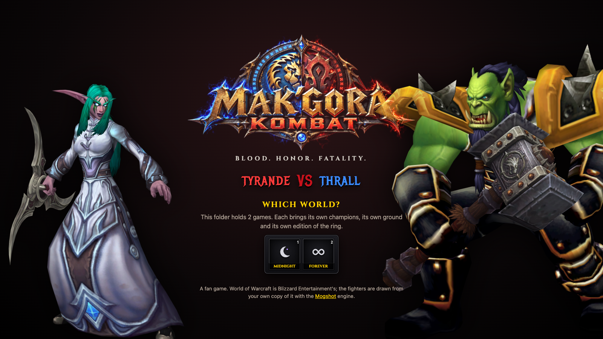
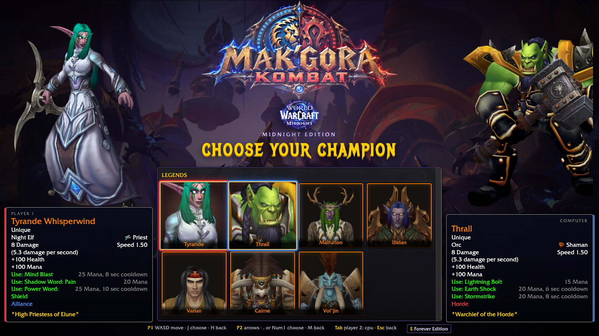
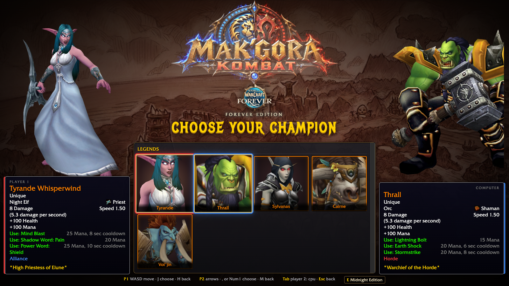
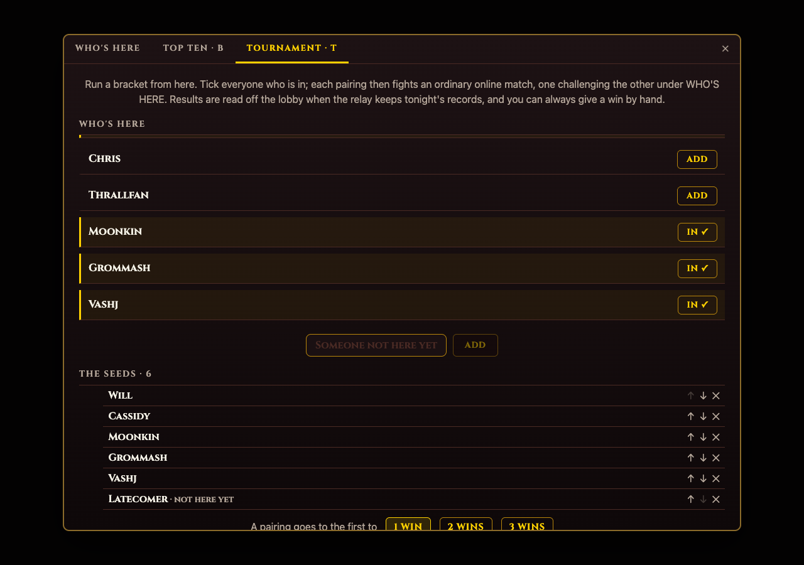
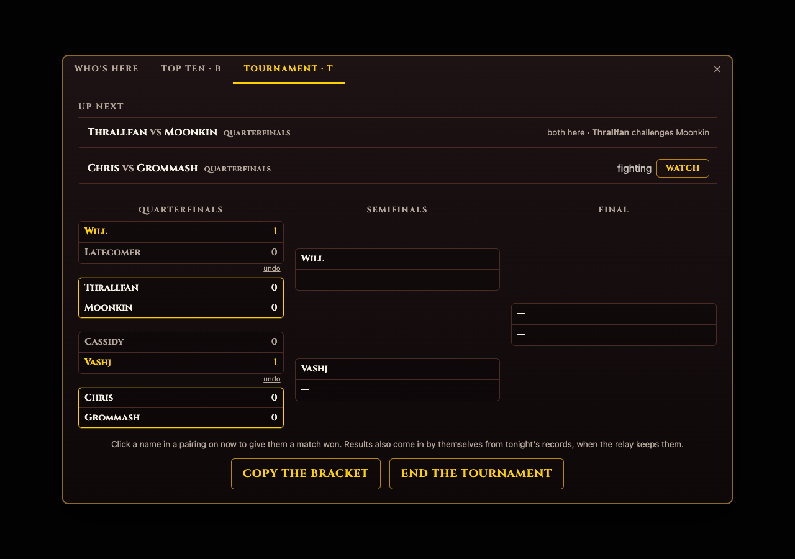

# MAK'GORA KOMBAT

BLOOD. HONOR. FATALITY.

A one-on-one fighting game played with World of Warcraft characters, in your browser, drawn from the game files already on your computer. No account, no server: drop your World of Warcraft folder on the page and the fighters, their gear and their animations are read from your own install and never leave your machine.

Play: https://realworldbuilder.github.io/makgorakombat/

The welcome page, for sharing: https://realworldbuilder.github.io/makgorakombat/welcome/ (`welcome/`, built to the landing-page-design skill).

## How it plays

1. Drag your `World of Warcraft` folder onto the page (it is in `Applications` on a Mac). Chrome on a Mac is what it is made for. A folder that holds more than one game (retail beside WoW Forever, say) asks **which world** to fight in; **E** on the champion screen switches to the other.
2. **CHOOSE YOUR CHAMPION.** Every race the game lets you create is on the grid, in the game's own portraits; your own characters, as captured by the [Mogshot addon](https://github.com/realworldbuilder/mogshot/tree/main/addon/Mogshot), are in the row above with their real gear; above those, the **LEGENDS**: Tyrande, Thrall, Sylvanas, Malfurion, Illidan, Varian, Cairne and Vol'jin, drawn exactly as the game draws them (the NPC's own gear, face and painted body), as far as your install has them. For now the ring is the legends' alone; add `?all` to the address (https://realworldbuilder.github.io/makgorakombat/?all) for every race and your own characters. Both players' cursors are on the grid at once. Resting on a tile summons that champion full size on your side; choosing makes them roar.
3. The **VS** screen: pick the ground. The stages are real places in the game world, read from the open folder's map files and raised around the fighters while they wait: Gurubashi Arena's pit, the Crossroads, the Valley of Heroes, Goldshire's lawn, the gardens of Darnassus and Thunder Bluff's rise (`src/game/stages.ts`). The strip shows the stages the open install has maps for; the Valley of Heroes is only on a classic world, since Cataclysm rebuilt it. An install with none of those maps fights in front of the game's loading screens instead, flat pictures behind the ring.
4. Best of three rounds, sixty seconds each. Take the other champion's health to nothing and they are dazed: **FINISH THE MAK'GORA!** You have four seconds. Enter your class's **fatality** sequence (it is shown on your side of the screen) and the execution plays; an ability that lands without it is the plain finisher; either is **DISHONOR!** A swing, or the clock, is a mere **K.O.** A round won untouched is **HONOR RESTORED**.

### Editions

Each game in the folder is its own edition of the ring, because each one's files hold different champions and different ground. CHOOSE YOUR CHAMPION is dressed as that game's login screen: the edition's name under our logo, one of its loading screens behind the champions, its title music, its colours (`src/game/edition.ts`, every picture and track read from the install by file id). The games' official logos are not used.

| | Midnight Edition (retail, `wow` 12.x) | Forever Edition (WoW Forever, `wowf` 1.60, and its beta) | Classic Edition (`wow_classic_era` and the other classic clients) |
|---|---|---|---|
| Legends | Tyrande, Thrall, Malfurion, Illidan, Varian, Cairne, Vol'jin, in their newest looks with their artifacts | Tyrande, Thrall, Sylvanas, Cairne, Vol'jin, in their first looks with the weapons the old files name | as Forever, as far as the files have them |
| Races and classes | 31 races (every allied race, the Dracthyr, Earthen and Haranir), 13 classes | the eight 2004 races and the two Skyborne, the nine 2004 classes | the 2004 races and classes |
| Stages | the five on the rebuilt world | all six, the Valley of Heroes too (Cataclysm rebuilt it on retail) | all six up to Wrath Classic; the rebuilt world from Cataclysm Classic on |
| Login screen | the Assault on Quel'Danas screen, Midnight's main title, void violet | its inked Kalimdor screen, *Legends of Azeroth*, bronze and teal | the 2004 continent screens, *Legends of Azeroth* |
| Spells | newer visuals, mostly particles the renderer leaves to `fx2d.ts` | the old spell models (Lightning Bolt's ball, Wrath's orb) | the old spell models |





### The fight is World of Warcraft's

Hold the attack key and your champion **auto-attacks on the weapon's swing timer** whenever the other is in reach: every 1.5 s with a one-hander or bare hands, 2.4 s with a two-hander, and a bow, gun or crossbow shoots every 2.0 s from anywhere on the stage (three quarters of the game's timers, so the ring keeps moving). A tap queues one swing. Every blow is rolled twice, as the game rolls it. First on the hit table: **miss**, **dodge** (the Dodge animation), **parry** (only from the front, and the parrier's next ability is a sure crit), **block** (a shield takes 40 % off), **crit** (double for a blow, half again for a spell) or a plain hit. Then in its damage range, like a weapon's 70 to 131: a two-hander strays 30 % either side of its average, a one-hander 25 %, a melee ability 15 %, a spell 8 %. No two swings need land alike, and the tooltips give the range ("Strikes the target for 14 to 19 damage"). Spells cannot be dodged or parried; a bolt in flight can still be jumped over.

The fighters stand as far apart as their bodies need, read from each model: a gnome can stand closer than a human, and Cairne, hunched forward over his hooves, stands well off. Walking into the other fighter stops at their body rather than shoving them across the ring, and reach grows with size as the game's combat reach does, so a big fighter and whoever faces him still hit from where they stand.

Each class has **three abilities** on the action bar beside the auto-attack, on a 1.0 s global cooldown and their own cooldowns, paid for in the class's resource, shown under the health bar in its colour: rage (builds on swings and on being hit), energy and focus (regenerate fast), mana (regenerates slowly), runic power and fury (build on swings). Casts fill a bar over the caster's head and are cancelled by moving; a blow sets the bar back half a second, twice at most, as in the game, and a stun, a fear or an interrupt ends it (the interrupt also locks the caster out for two seconds). Stuns (stars over the head), slows, fears, damage over time (a tick every 3 s), heals and absorb shields all float off the fighters as numbers and words, in the game's own damage font (Skurri, read from the install): they appear in the air beside the fighter who took them, on the far side from the other, and arc up and away, a flurry fanning out down the body. White for a blow you deal, a spell in its school's colour (frost blue, fire orange, shadow violet, nature green, holy gold, arcane pink), red for what you take, large for a crit and a little larger the harder the hit. A legend without a class fights as a **champion** with a warrior's kit, or a hunter's behind a bow.

The kits are deliberately unalike: a warrior's slow heavy swings and Mortal Strike, a rogue's quick light strikes and stuns, a mage's slow big bolts, a priest's damage over time and shield. What evens them out is what the game uses in PvP, a **damage modifier per class** (`PVP_DAMAGE` in `src/engine/abilities.ts`) that scales everything a class deals without changing what its spells do, and a **weapon skill** (`WEAPON_SKILL`): a caster's swing lands a little over half its weapon's damage, its strength is in its spells. The modifiers come from playing every class against every other, the computer on both sides, hundreds of rounds; over them every class wins between 46 % and 54 % of its rounds, while each still has the matchups it is good and bad at (a rogue beats a hunter three times in four and loses to a paladin four times in five). `BALANCE=1 pnpm test` prints the whole table; the tests fail if a class drifts outside 38 to 62 %.

| Class | 1 | 2 | 3 |
|---|---|---|---|
| Warrior (rage) | Charge: closes from afar, 4–5 damage, stuns 1 s, gives 20 rage, 15 s cooldown | Mortal Strike: 30 rage, 14–19 damage, 6 s cooldown | Execute: 15 rage, 23–31 damage, only under 20 % health |
| Paladin (mana) | Crusader Strike: 15 mana, 10–14 damage, 4.5 s cooldown | Hammer of Justice: 15 mana, 3–4 damage, stuns 2 s, 20 s cooldown | Holy Light: 30 mana, 2 s cast, heals 35 |
| Hunter (focus) | Aimed Shot: 35 focus, 1.5 s cast, 19–22 damage | Disengage: leaps back, 15 s cooldown, no global cooldown | Kill Shot: 10 focus, 23–28 damage, only under 20 % health |
| Rogue (energy) | Sinister Strike: 40 energy, 8–11 damage | Kidney Shot: 25 energy, 4–6 damage, stuns 2 s, 20 s cooldown | Evasion: dodge up for 8 s, 30 s cooldown, no global cooldown |
| Priest (mana) | Mind Blast: 25 mana, 1 s cast, 28–33 damage, 4 s cooldown | Shadow Word: Pain: 20 mana, 10 damage every 3 s, five times | Power Word: Shield: 25 mana, absorbs 25, 10 s cooldown |
| Death Knight (runic power) | Icy Touch: 8–9 damage, slows 3 s, gives 15 runic power, 6 s cooldown | Death Strike: 12–16 damage, heals 10, gives 15 runic power, 6 s cooldown | Death Coil: 40 runic power, 13–15 damage |
| Shaman (mana) | Lightning Bolt: 15 mana, 1.5 s cast, 19–23 damage | Earth Shock: 20 mana, 10–12 damage, interrupts, 6 s cooldown | Stormstrike: 20 mana, 15–20 damage, 8 s cooldown |
| Mage (mana) | Frostbolt: 20 mana, 1.5 s cast, 22–26 damage, slows 4 s | Fire Blast: 25 mana, 15–18 damage, 8 s cooldown | Blink: 15 mana, 3.5 yards away, 15 s cooldown |
| Warlock (mana) | Shadow Bolt: 20 mana, 1.5 s cast, 29–34 damage | Corruption: 20 mana, 9 damage every 3 s, five times | Fear: 20 mana, 1 s cast, the target flees 2.5 s, 20 s cooldown |
| Monk (energy) | Tiger Palm: 35 energy, 7–9 damage | Rising Sun Kick: 30 energy, 12–17 damage, 8 s cooldown | Leg Sweep: 25 energy, 4–6 damage, stuns 2 s, 20 s cooldown |
| Druid (mana) | Wrath: 15 mana, 1.5 s cast, 18–21 damage | Moonfire: 20 mana, 8–10 damage, then 5 damage every 3 s, four times | Rake: 25 mana, 8–11 damage, then 5 damage every 3 s, three times |
| Demon Hunter (fury) | Chaos Strike: 30 fury, 18–24 damage | Fel Rush: dashes 4 yards, 9–12 damage, gives 20 fury, 10 s cooldown | Blade Dance: 30 fury, 14–19 damage on both sides, 9 s cooldown |
| Evoker (mana) | Living Flame: 15 mana, 1.5 s cast, 21–25 damage | Fire Breath: 25 mana, 18–21 damage, then 4 damage every 3 s, three times, 12 s cooldown | Hover: leaps back, 15 s cooldown, no global cooldown |

Every move is one of the character's own animations: Ready stances by weapon, Attack swings with all their variations, the class's own casts (MagSpellCastBothFront, PriSpellCastBothUp, ShaSpellCastBothFront...), CombatChargeLoop and CombatChargeEnd, CombatExecute, Stormstrike, DeathStrike, FelRush, DHBladeDance, RisingSunKick, Dodge and Parry, battle roars, cheers, combat wounds, stuns, knockdowns and deaths, as the game plays them, with a plain strike or cast standing in where a model lacks one.

### Fatalities

Under FINISH THE MAK'GORA! the winner's keys are read as a sequence. The prompt on the winner's side shows the fatality's name and a slot per key: a lit slot is a key landed, the ring around the next counts its 1.5 s down, and the bar under them is the four-second window. A wrong key empties the slots and locks them for half a second (a direction before the first key is just walking). The attack and ability keys the sequence takes fire nothing; one it refuses fires as usual. The computer enters its own sequence too, and fumbles a key now and then. **Back** and **forward** are relative to the way your champion faces: for player 1 facing right, back is A and forward is D; for player 2 facing left, back is → and forward is ←. The ability keys are K L U for player 1, . / Right Shift for player 2, A B X on a pad; attack is J, , or the right trigger.

| Class | Fatality | Sequence | The scene |
|---|---|---|---|
| Warrior | Bladestorm | back, forward, back, ability 2 | charges in, spins through them (CombatBladeStorm), they kneel, the execute |
| Paladin | Hammer of Wrath | forward, forward, ability 2, attack | a pillar of light, a hammer blow that floors them, the execute |
| Hunter | Rapid Fire | back, back, ability 1, attack | leaps back, a volley of arrows, the kill shot |
| Rogue | Eviscerate | back, forward, ability 1, ability 1, attack | steps behind them, two strikes, the eviscerate |
| Priest | Shadow Word: Death | back, back, ability 2, ability 1 | shadow gathers, a channel that wracks them, the word |
| Death Knight | Soul Reaper | forward, back, ability 2, attack | a death grip drags them in, a frost strike, the reap |
| Shaman | Thunderstorm | back, forward, ability 1, ability 2 | lightning from the sky twice, a charge, Stormstrike |
| Mage | Deep Freeze | back, back, forward, ability 1 | frost grows over them, a frozen beat, the shatter |
| Warlock | Drain Soul | forward, back, ability 2, ability 1 | shadow, a long drain, the burst |
| Monk | Touch of Death | forward, forward, attack, ability 1 | a flying kick, a roundhouse, the touch |
| Druid | Starfall | back, forward, ability 2, ability 1 | moonlight, stars that fall on them, the last star |
| Demon Hunter | Eye Beam | back, forward, forward, ability 3 | Fel Rush, Blade Dance, a hop back and the beam |
| Evoker | Deep Breath | back, back, ability 2, attack | takes to the air, a breath of fire, the last breath |

Each beat is one of the winner's own animations (CombatBladeStorm, CombatExecute, CombatEviscerate, DeathStrike, Stormstrike, PalmStrike, DHBladeDance1, BreathOfFire, the class casts and channels...) with a plain strike or cast standing in where the model lacks one, and the loser's Stun, Cower, CombatCritical, Knockdown and Death. The scene runs in slow motion with the camera pushed in, letterboxed, with the class's effect drawn over the pair, and ends under **DISHONOR!** with the fatality's name. A legend without a class plays the warrior's, or the hunter's behind a bow.

The effects are particles on the HUD's canvas (`src/game/particles.ts`, the script in `src/game/fatalityFx.ts`): steel sparks and dust round the Bladestorm, a pillar of gold motes that comes down in a ring of light, arrows trailing sparks into a burst of feathers, arcs of blood off each strike, shadow winding into the loser, ice shards, sparks shed by the bolts, falling stars, fel embers along the beam, a cone of fire and black smoke. The pool is stepped once a tick from a seed made of the frame the fatality began on and the beat, and its particles hang off the fighters' hands, chests and feet rather than the screen, so both players of an online match see the same sparks, and a pool rebuilt after a stall or a rematch is the same as one that was there all along. `tools/fatality-fx/` drives the engine into each fatality on stand-in figures without a game folder; one sheet per class in [docs/fatality-fx-&lt;class&gt;.png](docs/).

### Controls

| | Player 1 | Player 2 |
|---|---|---|
| Move | A / D | ← / → |
| Jump | W | ↑ |
| Attack (hold to auto-attack, tap for one swing) | J | , or Numpad 0 |
| Ability 1 | K | . or Numpad 1 |
| Ability 2 | L | / or Numpad 2 |
| Ability 3 | U | Right Shift or Numpad 3 |

There is no block key: a shield blocks and a weapon parries on their own, as in the game. On a gamepad the abilities are A B X, the right trigger attacks, Y, a bumper or up jumps.

Press **C** on the roster for the game's own keys: player 1 moves and jumps with the arrows, **1** attacks and **2 3 4** are the action bar, as in World of Warcraft; player 2 then takes WASD and J K L U. The choice is remembered in the browser.

On the roster: WASD / arrows move the cursor, J or , choose, H or M go back, U or Right Shift switch sex, K L or . / cycle the class (on the game's own keys: arrows, 1 or Enter, Backspace, 4, 2 and 3). **Tab** switches player 2 between the keyboard, a gamepad and the computer. **Enter** rematches, **Esc** goes back, **F3** shows frame times. **M** mutes in a fight or in SETTINGS, and **P** turns the music off and on from any screen (outside a text field).

The fight's sound is read from the game folder like everything else: weapon swings and impacts by the weapon's subclass, the race's own grunts, wounds, death cry and battle roar, a spell for the class (Fireball for a mage, Shadow Bolt for a warlock, Lightning Bolt for a shaman...), and a gong for each round. The music is the game's too: the login screen's theme under CHOOSE YOUR CHAMPION, and on the VS screen the zone music of the stage under the cursor (Stranglethorn's jungle for Gurubashi, Stormwind's for the Valley of Heroes...), which plays on, quieter, through the fight and drops away under a fatality. The music has its own switch, apart from the mute: **P**, the note tab beside the bug tab at the top of the roster, the VS screen and the fight, or MUSIC in SETTINGS (remembered in the browser) turns only the music off, and the fight's sounds and the call when a match is found keep playing. Browsers keep audio off until a key is pressed, so the first screen may start quiet.

### Online

**PLAY ONLINE** (6 on the title, **O** on the roster) fights a friend on another computer. Each of you opens the game with your own World of Warcraft folder and gives a name once; WHO'S HERE then lists everyone else with the game open, and FIGHT beside a name challenges them (they ACCEPT or DECLINE within thirty seconds, over whatever screen they are on), or QUICK MATCH waits for whoever asks next. Whoever challenges, or waited longer, is player 1 and picks the ground; two players on different relays can still use a room code, under "join with a code". Chris's copy is at [makgora.clawdioslave.com](https://makgora.clawdioslave.com/), so a friend needs only the link; both play on player 1's keys. Nothing of the game files is sent: both machines run the fight themselves in lockstep and only the key presses cross, through a small relay ([`relay/`](relay/README.md), a Cloudflare Worker) that passes them on and keeps nothing. Each press is played four ticks (67 ms) after it is made, on both machines alike; if the other's presses are late the fight holds and says WAITING FOR OPPONENT. The host's move tables run both engines, so a retail and a classic install stay in step while each draws its own animations. SETTINGS names the relay; anyone can deploy their own.

**TOURNAMENT** (T in PLAY ONLINE) is for whoever runs a night: tick the players here (or type the names of those still coming; they are linked when they arrive), set the seeds or SHUFFLE, choose whether a pairing goes to the first to 1, 2 or 3 match wins, and START THE BRACKET. It is single elimination, seed 1 meeting seed 2 only in the final and byes to the top seeds. UP NEXT lists the pairings to be fought now and where each stands: who has not come yet, who challenges whom once both are here (a FIGHT button when it is you), and WATCH while they are at it. Each pairing is an ordinary online match from WHO'S HERE. Results come in by themselves from the lobby's records tonight (one side's new win that is the other's new loss), where the relay keeps them; clicking a name in a pairing gives that side a match by hand, and UNDO takes a result back. COPY THE BRACKET gives it as text for the chat. The bracket is kept in the organizer's browser and nothing about it goes to the relay (`src/game/cup.ts`, `src/game/Tournament.tsx`).




## Running it yourself

```
git clone --recurse-submodules https://github.com/realworldbuilder/makgorakombat.git
cd makgorakombat
pnpm install
pnpm dev
```

The engine (CASC reader, model and animation parsers, skinning, WebGL renderer, the worker that reads the folder) is [Mogshot](https://github.com/realworldbuilder/mogshot), brought in as the submodule `vendor/mogshot`. To work on both at once, point the game at a checkout of Mogshot: `MOGSHOT_SRC=../mogshot/src pnpm dev`.

`pnpm test` runs the engine's tests (the fight itself is deterministic and runs without a browser), the lockstep's over a wire in memory, and the handshake's; `MAKGORA_LIVE=1 pnpm vitest run test/game/online.live.test.ts` plays twenty seconds through the deployed relay. The relay has its own tests: `cd relay && pnpm test`. `pnpm build` makes the static site in `dist/`; every merge to `main` deploys it to GitHub Pages, and [makgora.clawdioslave.com](https://makgora.clawdioslave.com/) follows `main` within a few minutes. The relay is never redeployed by a merge: redeploying it closes every room, so a match in progress would end; relay changes go up at a quiet hour. Working on it together: [CONTRIBUTING.md](CONTRIBUTING.md); every change goes through a pull request.

To put up your own copy of both on a Cloudflare account (the free plan is enough), with wrangler logged in (`cd relay && pnpm install && pnpm exec wrangler login`):

- The relay: `cd relay && pnpm run deploy`. It prints `https://makgora-relay.<your-subdomain>.workers.dev`; set `RELAY_URL` in `src/game/net/relay.ts` to it (or name it in SETTINGS), and add your site's origin to `allowedOrigin` in `relay/src/index.ts`.
- The game: set the domain in `site/wrangler.jsonc` (`routes`, a hostname on a zone in your account, or drop `routes` for `makgora.<your-subdomain>.workers.dev`), then `pnpm run deploy:site` from the root. It builds with `VITE_BASE=/`, since the page is at the root of its own host rather than under `/makgorakombat/` as on GitHub Pages, and uploads `dist/` as the static assets of a Worker named `makgora`, every path that is not a file answering with the page.

### Stages

A stage is a spot in the world in `src/game/stages.ts`: the map, the coordinates the game's `/mogshot spot` prints (x north, y west, in yards), a `facing` in degrees anticlockwise from north, and the `reach` in yards the world is drawn to. The fighters stand along the line through the spot that runs the way `facing` points, and the camera looks across it, toward `facing` + 90°, so the backdrop is whatever lies that way: pick the facing so the best view is across the line, not along it. The fight itself is flat; the floor along the line is read from the place once (`src/game/ground.ts`) and each fighter and their shadow is drawn that much higher or lower, so a leaning lawn still works, but a staircase does not. A `z` picks a storey where the highest surface is the wrong one (a city's streets over its sewers, say).

To try a spot before adding it, render it through Mogshot's command line with the game's camera and look at the PNG:

```bash
pnpm mogshot render spot.json --wow "/Applications/World of Warcraft" --product wow
# spot.json: [{"out": "spot.png", "race": "Human", "sex": "male", "pose": "Ready", "size": {"width": 960, "height": 540, "tight": false},
#             "place": {"map": 0, "x": -13215, "y": 250, "facing": 0}, "camera": {"yaw": -90, "pitch": 7, "fov": 32, "zoom": 2.6}}]
```

A camera `pitch` of 80 and a `zoom` of 40 gives a map of the hundred yards around a spot, for finding the open ground. The thumbnails in `public/stages/<slug>.jpg` are the same render of the empty place (`"empty": true`), shrunk to 320 × 180.

### Legends

A legend is a creature display id in `src/game/roster.ts` (`LEGENDS`), built through the worker's `fighter` request with `npc` set, with a `classId` for the kit it fights with (Tyrande a priest, Thrall and Vol'jin shamans, Sylvanas a hunter, Malfurion a druid, Illidan a demon hunter, Varian and Cairne warriors) and its weapons as kits in order of preference: retail's artifact first (the Doomhammer, G'Hanir, the Warglaives of Azzinoth, Felscorned Shalamayne), then the NPC weapon the classic files name (Monster - Mace, Thrall's Hammer; the Moonglaive; Cairne's Totem; Vol'jin's glaive). The first kit the open install has is worn; with none, the legend takes its class set's weapon rather than fight bare-handed. The move table follows the weapon, so a two-hander stands and swings as one and a bow shoots ([docs/legends-armed.png](docs/legends-armed.png)). Only a display drawn on a player model works: the newer looks of most of these characters (Jaina since Mists, retail's Sylvanas and Anduin, the Lich King, Garrosh, Velen, Grommash) are unique models, which is why they are listed with a note and get no tile. Each legend lists its retail look first and its classic one after it; the game uses the first one the open folder has, so the row is shorter on the classic beta.

To check or add one, with Mogshot's command line pointed at an install (`--wow`, `--product`):

```bash
pnpm mogshot npcs Thrall          # the display ids the files name for a character
pnpm mogshot render spec.json     # {"npc": 19015} draws it; a look with a model of its own still draws, but cannot fight
```

The portraits in `public/legends/<slug>.png` are face crops rendered once with the same command (`"camera": {"zoom": 0.3, "panY": -2}` or so, tuned by eye for each model's height), since the browser has no portrait atlas for NPCs.

After the legends stands a champion built into the game, **Cassidy Darkstar**, Chris's night elf druid: a made champion like the player's own (`BUILTIN_CHAMPIONS` in `src/game/saved.ts`, the appearance choices and item ids by number), shown ahead of the CREATE tile, never written to the browser's storage, and not editable or deletable in the creator. [docs/cassidy.json](docs/cassidy.json) draws the same look through the command line ([docs/cassidy.png](docs/cassidy.png)): Crimson Silk Robe, the white Moonlit Amice and the Staff of Jordan, white hair and beard on the grey-lavender skin of her portrait.

### Spells

Each ability's look is read from the game too. The worker's `spellVisuals` request walks SpellXSpellVisual, SpellVisualMissile, SpellVisualEvent, SpellVisualKitEffect and SpellVisualKitModelAttach to the models a spell draws: the missile, what glows in the hands while the bar fills, the release, the impact and the aura. `spellModels` builds them as small scenes, merged into the ring beside the fighters and posed each frame on the projectile, the hands or the target (`src/game/fx.ts`). The renderer draws meshes but not particles or ribbons, so a spell made only of particles has no model; over the models, `src/game/fx2d.ts` draws every legend's spell in light, timed off the engine's spell events: forked lightning by midpoint displacement, a moonbeam, a gold bubble, arrows with streaks, fel fire, slash crescents, dust and smoke. On the classic beta Lightning Bolt (its ball and the crackle in the hands), Earth Shock, Stormstrike, Power Word: Shield's ring, Wrath, Moonfire's column, Rake and the hunter's arrow have models; retail's newer visuals are mostly particles. One sheet per legend in [docs/legend-fx-&lt;legend&gt;.png](docs/).

## A fan game

World of Warcraft and its art are Blizzard Entertainment's, and are only ever read from your own copy of the game. Mortal Kombat is NetherRealm's and Warner Bros.'; this borrows the shape of its fights and nothing of its assets. Not affiliated with either.
